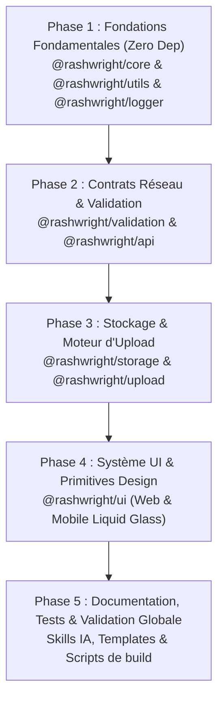

# Plan d'Implémentation de l'Écosystème Monorepo Rashwright

**Version :** 1.0  
**Gestionnaire de paquets :** Bun (v1.4.x)  
**Règle stricte d'isolation :** Aucun fichier des projets de production (`immo360-web`, `immo360-mobile`, `rashwright-identity`) ne doit être modifié ou altéré. Tout le développement, la standardisation, les améliorations et les créations de modules se font exclusivement au sein de `packages/`.

---

## 1. Vision et Objectifs de l'Écosystème

L'objectif de Rashwright est de standardiser l'ensemble des modules réutilisables, conventions d'architecture et compétences (skills) pour tous les projets actuels et futurs (Web, Mobile et API), en suivant les spécifications de `packages/prompts/architecture-v1.md` et `packages/prompts/matrice.md`.

### Principes Clés
1. **Extract & Improve, Don't Copy** : Les logiques et composants copiés dans `packages/ui/web` et `packages/ui/mobile` sont épurés de tout couplage métier (ex: suppression des identifiants Cloudinary codés en dur) pour devenir des primitives génériques robustes.
2. **Modularité et zéro sur-abstraction** : Chaque package a un périmètre strict et un minimum de dépendances.
3. **Conventions de nommage rigoureuses** :
   - Fichiers et dossiers : `kebab-case` strict (ex: `property-card.tsx`, `empty-state.tsx`).
   - Types, Interfaces et Composants React : `PascalCase`.
   - Variables, Fonctions et Hooks : `camelCase` / `useCamelCase`.
   - Constantes globales : `UPPER_SNAKE_CASE`.

---

## 2. Architecture du Monorepo `packages/`

```text
packages/
├── core/             # Primitives de base, ApiResponse, Result, Erreurs standard, Pagination
├── utils/            # Utilitaires purs (formatters, dates, manipulation de chaînes et collections)
├── logger/           # Logger universel structuré (Node, Web, React Native)
├── validation/       # Schémas et helpers de validation Zod réutilisables
├── api/              # Client HTTP universel (Axios), intercepteurs d'auth, helpers de réponses serveur
├── storage/          # Abstraction Key-Value uniforme (Memory, LocalStorage, MMKV, SecureStore)
├── upload/           # Moteur d'upload abstrait, providers (Cloudinary, S3, Local), compression & progression
├── ui/               # Design system & Primitives UI (séparé Web / Mobile)
│   ├── web/          # Composants UI Web (extension shadcn/ui, Tailwind v4)
│   └── mobile/       # Composants UI Mobile (Liquid Glass UI, Reanimated rubber, Expo)
└── prompts/          # Spécifications d'architecture et matrices de référence
```

---

## 3. Décomposition et Rôle de Chaque Package

### 3.1 `@rashwright/core`
* **Rôle** : Socle commun zéro dépendance pour l'ensemble des applications et des autres packages.
* **Contenu** :
  - `result.ts` : Type `Result<T, E>` pour la gestion explicite du succès ou de l'échec.
  - `response.ts` : Contrats universels `ApiResponse<T>`, `ApiSuccess<T>`, `ApiFailure`.
  - `errors.ts` : Classes d'erreurs typées (`AppError`, `ValidationError`, `NotFoundError`, `UnauthorizedError`, `ForbiddenError`, `ConflictError`).
  - `pagination.ts` : Contrats et helpers `PaginationParams`, `PaginationMeta`, `buildPaginationMeta`.
  - `types.ts` : Primitives d'identifiants, types utilitaires (`Nullable`, `DeepPartial`, etc.).

### 3.2 `@rashwright/utils`
* **Rôle** : Fonctions utilitaires génériques pures, sans état, hautement testées et documentées.
* **Contenu** :
  - `format-bytes.ts` / `format-file-size.ts` : Formatage lisible des tailles de fichiers.
  - `format-currency.ts` : Formatage monétaire multi-devises (XOF, EUR, USD, etc.).
  - `slugify.ts` : Génération sécurisée de slugs URL.
  - `string.ts` : Truncate, capitalize, sanitize.
  - `math.ts` : Clamp, round, percentage.
  - `collections.ts` : Group-by, unique, chunk, sort-by.
  - `url.ts` : Helpers de Query String et parsing de paramètres.

### 3.3 `@rashwright/logger`
* **Rôle** : Logger universel contextuel s'adaptant à l'environnement d'exécution.
* **Contenu** :
  - Niveaux : `debug`, `info`, `warn`, `error`.
  - Formatage contextuel : Horodatage ISO, métadonnées structurées, traces d'erreurs.
  - Comportement adaptatif :
    - Node.js (Next.js server, route handlers) : Sortie structurée JSON / console colorée.
    - Navigateur : Console stylisée, filtrage du debug en production.
    - React Native : Format compact évitant les surcharges de pont natif.

### 3.4 `@rashwright/validation`
* **Rôle** : Schémas et helpers de validation basés sur Zod, prêts à l'emploi.
* **Contenu** :
  - Schémas transverses : `paginationSchema`, `idSchema` (UUID, CUID, numeric), `dateRangeSchema`.
  - Schémas d'upload : types MIME autorisés, limites de taille en Mo/Ko.
  - Helpers : `safeParseOrThrow`, adaptateur d'erreurs Zod vers `ValidationError` de `@rashwright/core`.

### 3.5 `@rashwright/api`
* **Rôle** : Couche de communication HTTP standardisée pour les clients et helpers pour le backend.
* **Contenu** :
  - `client/` : Factory de client Axios configuré (`createApiClient`), gestion des timeouts, retry automatique.
  - `interceptors/` : Injection dynamique du Bearer Token (Firebase Auth, BetterAuth, JWT), gestion du refresh token.
  - `error-handler/` : Transformation automatique des erreurs HTTP et payloads en `ApiError` normalisées.
  - `server/` : Helpers de réponses pour route handlers Next.js (`success`, `created`, `updated`, `deleted`, `badRequest`, `unauthorized`, `handleError`).

### 3.6 `@rashwright/storage`
* **Rôle** : Abstraction Key-Value unifiée pour l'état et la persistance.
* **Contenu** :
  - Interface `IStorageDriver` : `get<T>`, `set<T>`, `remove`, `clear`, `has`.
  - Drivers :
    - `MemoryStorage` : Idéal pour tests unitaires et environnements sans DOM.
    - `LocalStorageDriver` / `SessionStorageDriver` : Pour les applications Web.
    - `MMKVDriver` : Ultra-rapide pour React Native (`react-native-mmkv`).
    - `SecureStoreDriver` : Pour les jetons sensibles sur Mobile (`expo-secure-store`).
    - `SQLiteDriver` : Stockage structuré et requêtable pour les projets avec SQLite (Expo SQLite, Drizzle ORM, better-sqlite3).

### 3.7 `@rashwright/upload`
* **Rôle** : Moteur d'upload et de gestion de médias agnostique du fournisseur externe.
* **Contenu** :
  - Contrat `IUploadProvider` : `upload(file, options)`, `delete(fileId)`.
  - Providers :
    - `CloudinaryProvider` : Paramétré via configuration injectée (fini les clés et presets codés en dur !).
    - `S3Provider` : Stockage objet AWS / Wasabi / MinIO.
    - `LocalProvider` / `MockProvider` : Pour le développement et les tests.
  - Compression :
    - Adaptateur Web (`browser-image-compression` via Worker).
    - Adaptateur Mobile (`expo-image-manipulator`).
  - Suivi : Hooks de progression unifiés (`useUpload`, `useMultiUpload`).

### 3.8 `@rashwright/ui`
* **Rôle** : Primitives de composants et design system de référence.
* **Organisation** :
  - `web/` : Primitives d'interface web basées sur `shadcn/ui` et Tailwind v4. Nettoyage des composants de `packages/ui/web` (renommage en `kebab-case`, suppression des dépendances directes aux configs spécifiques).
  - `mobile/` : Système complet **Liquid Glass UI** issu de `immo360-mobile/.agents/skills/liquid-glass-ui`, avec physique élastique Reanimated, support `BlurView` iOS, fallback teinté Android, et palette sémantique débrayable (`liquidGlassEnabled`).

---

## 4. Priorisation et Ordre d'Implémentation



### Phase 1 : Fondations (Priorité Maximale)
1. Initialisation du monorepo Bun racine : `package.json` racine avec `workspaces: ["packages/*"]` et `tsconfig.base.json`.
2. Création et compilation de `@rashwright/core`.
3. Création et compilation de `@rashwright/utils`.
4. Création et compilation de `@rashwright/logger`.

### Phase 2 : Validation & API
1. Implémentation de `@rashwright/validation` (dépend de `@rashwright/core` et `zod`).
2. Implémentation de `@rashwright/api` (dépend de `@rashwright/core`, `@rashwright/logger`, `axios`).

### Phase 3 : Storage & Upload
1. Implémentation de `@rashwright/storage` (contrat unifié + drivers Web / Mobile).
2. Implémentation de `@rashwright/upload` (moteur sans secrets en dur, providers Cloudinary / S3, gestion de la compression).

### Phase 4 : UI Primitives (Web & Mobile)
1. Nettoyage et restructuration des composants copiés dans `packages/ui/web` pour les brancher sur `@rashwright/upload` et `@rashwright/utils`.
2. Consolidation de `packages/ui/mobile` sur la base du skill `liquid-glass-ui`.
3. Standardisation des noms de fichiers en `kebab-case` strict.

### Phase 5 : Documentation, Skills & Vérification
1. Finalisation des guides et skills pour les agents IA et développeurs.
2. Validation de la compilation Bun et génération des types `.d.ts` pour tous les packages.
